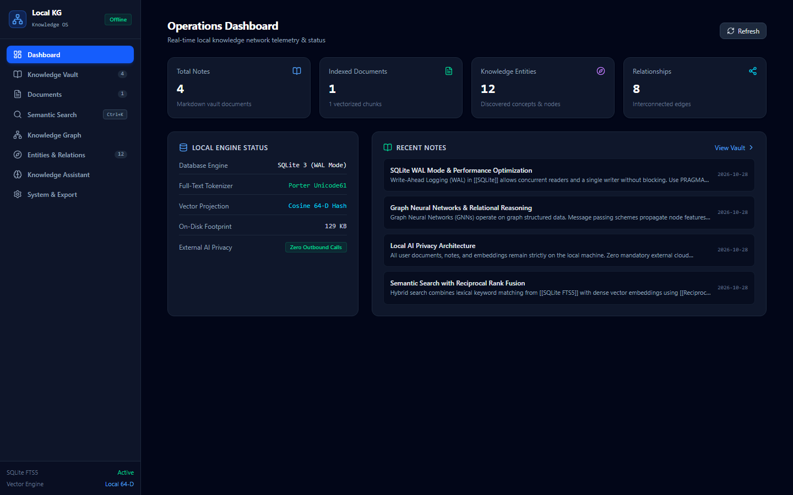
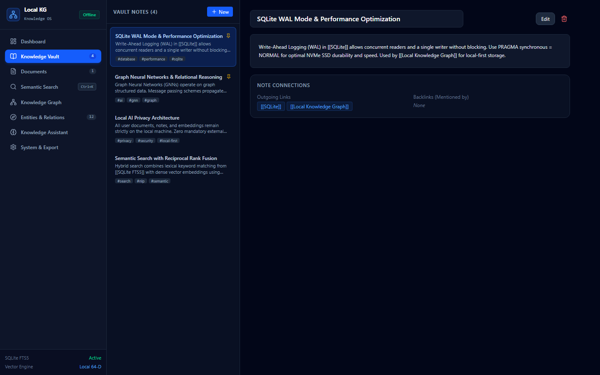
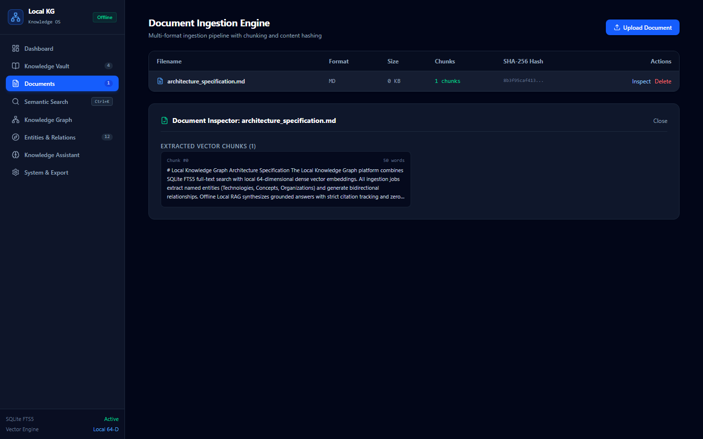
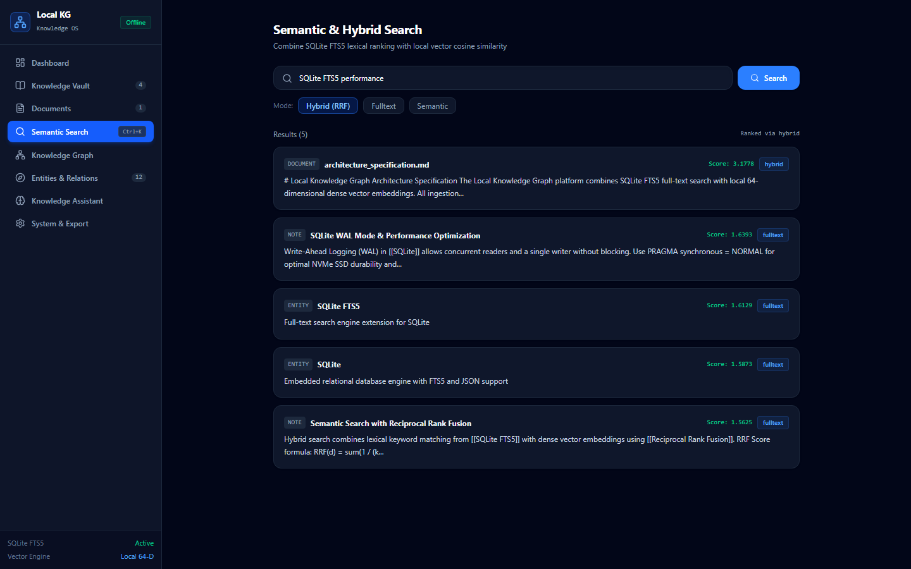
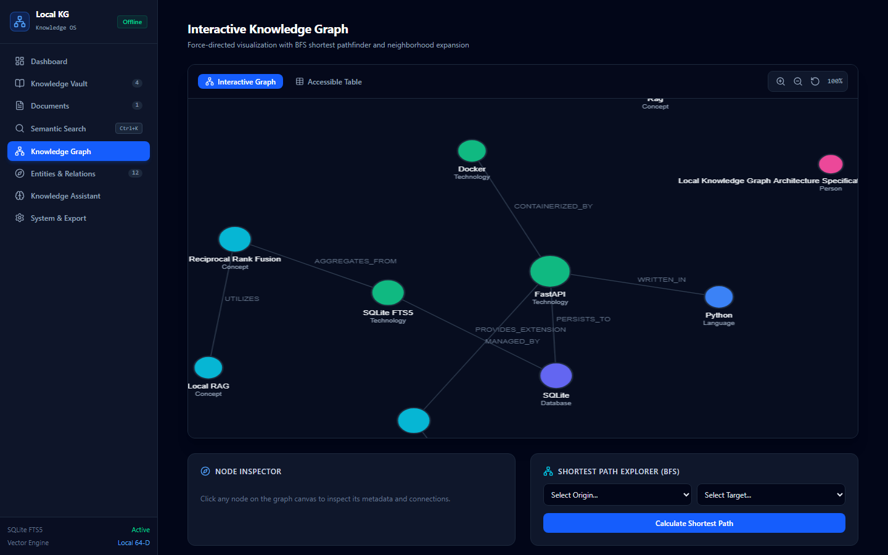
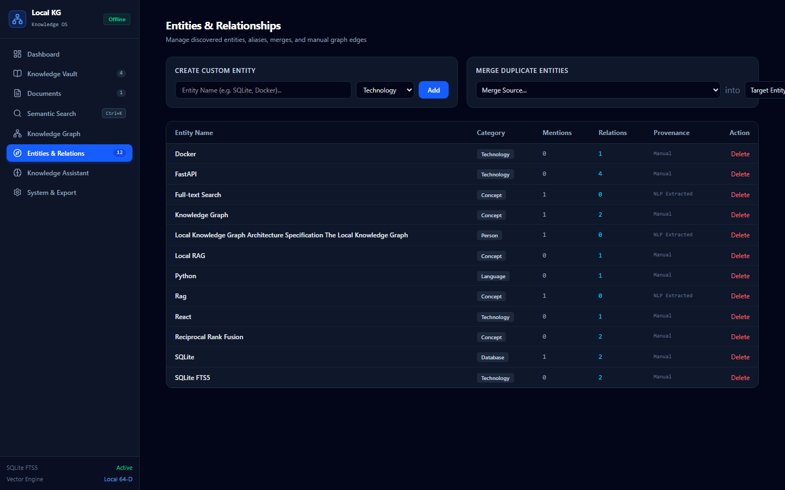
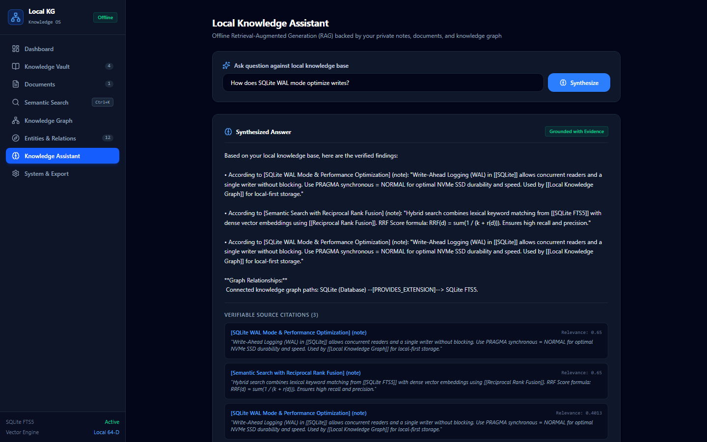
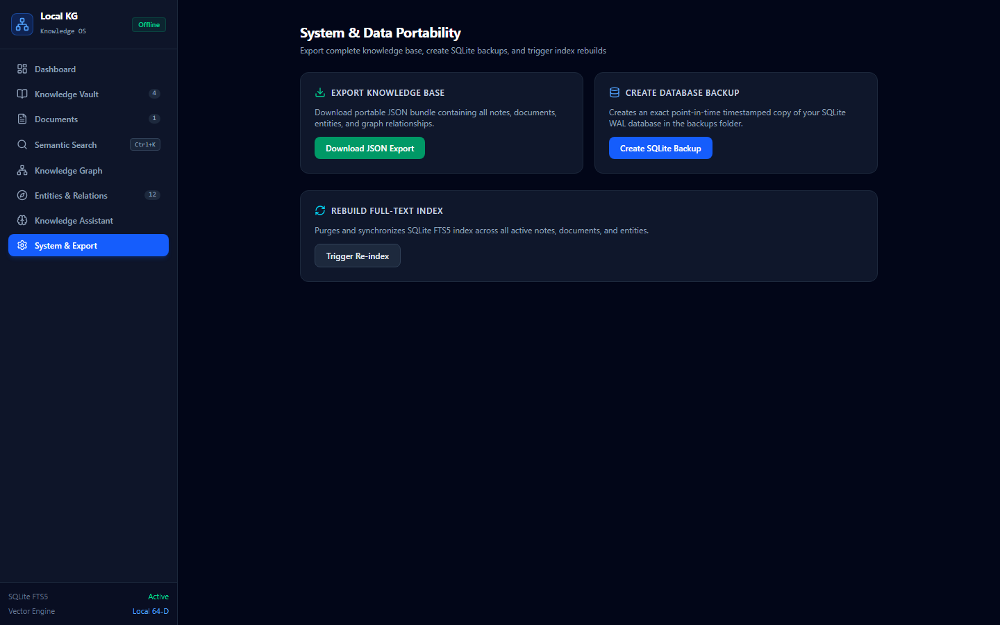

# Local Knowledge Graph 🕸️
### Local-First Knowledge Management & Semantic Search Platform

[](https://opensource.org/licenses/Apache-2.0)
[](https://www.python.org/)
[](https://react.dev/)
[](https://fastapi.tiangolo.com/)
[](https://www.sqlite.org/)
[](https://github.com/0xyz-exe/local-knowledge-graph)

**Local Knowledge Graph** is a modern, privacy-first, local-first personal knowledge operating system. It transforms disconnected notes, documents, and research materials into an interconnected knowledge network with full-text search, local vector semantic similarity, interactive force-directed graph exploration, and offline Retrieval-Augmented Generation (RAG) with zero mandatory paid APIs or external telemetry.

---

## 📸 Platform Screenshots

### 1. Operations Overview & System Telemetry
Real-time dashboard displaying total notes, vectorized document chunks, discovered entities, relationships, and on-disk footprint.


### 2. Knowledge Vault & Bidirectional Backlinks
Markdown note editor with live preview, wiki link syntax `[[Note Title]]`, hashtag indexing, and outgoing/backlink relationship tracking.


### 3. Document Ingestion Engine & Chunk Inspector
Multi-format ingestion pipeline supporting Markdown, TXT, JSON, CSV, and HTML with SHA-256 deduplication and vector chunk inspector.


### 4. Semantic & Hybrid Search (Reciprocal Rank Fusion)
Unified search engine offering Full-Text Search (SQLite FTS5), local dense vector cosine similarity, and hybrid ranking via Reciprocal Rank Fusion.


### 5. Interactive Knowledge Graph & BFS Pathfinder
Force-directed layout with physics simulation, zoom/pan controls, node category color coding, and Breadth-First Search (BFS) shortest pathfinder.


### 6. Entities & Relationships Management
Extracted entity catalog with category filtering, alias tracking, safe entity merging, and manual relationship creation.


### 7. Local Knowledge Assistant (Offline RAG)
Retrieval-Augmented Generation answering questions with verifiable source citations, document excerpts, and graph context without external cloud calls.


### 8. System Management & Data Portability
Full knowledge base JSON export, point-in-time timestamped SQLite database backups, and instant FTS5 index synchronization.


---

## 🏛️ Architecture Overview

```text
┌─────────────────────────────────────────────────────────────┐
│                 React 19 + TypeScript + Vite                │
│       Interactive Canvas Graph | Markdown Vault | Search    │
└──────────────────────────────┬──────────────────────────────┘
                               │ REST API (/api/v1)
┌──────────────────────────────▼──────────────────────────────┐
│                      FastAPI Backend Engine                  │
├──────────────────────────────┬──────────────────────────────┤
│    Ingestion Pipeline        │     Search & Discovery       │
│  - Multi-Format Parsing      │  - SQLite FTS5 (BM25)        │
│  - Content Hashing (SHA-256) │  - 64-D Vector Projection    │
│  - Text Chunking & Overlap   │  - Cosine Similarity & RRF   │
│  - Named Entity Extraction   │  - Graph BFS Shortest Path   │
├──────────────────────────────┴──────────────────────────────┤
│               Local Storage & Persistence                   │
│  - SQLite WAL (Write-Ahead Logging)                         │
│  - SQLite FTS5 Full-Text Virtual Table                      │
│  - Point-in-time JSON & SQLite Backups                      │
└─────────────────────────────────────────────────────────────┘
```

---

## 🚀 Getting Started

### Prerequisites
- **Python**: 3.11 or higher
- **Node.js**: 20 or higher
- **Package Managers**: `uv` (recommended) or `pip`, `npm`

### 1. Installation

```bash
# Clone the repository
git clone https://github.com/0xyz-exe/local-knowledge-graph.git
cd local-knowledge-graph

# Setup Python backend
uv venv .venv
source .venv/bin/activate  # Windows: .venv\Scripts\activate
uv pip install -r requirements.txt

# Setup Frontend
cd apps/web
npm install
cd ../..
```

### 2. Seed Demonstration Knowledge

```bash
python scripts/seed_data.py
```

### 3. Run Application

Start backend (Terminal 1):
```bash
python -m uvicorn backend.app.main:app --host 127.0.0.1 --port 8765
```

Start frontend (Terminal 2):
```bash
cd apps/web
npm run dev
```

Open `http://127.0.0.1:5173` in your browser.

---

## 🧪 Testing

Run backend tests and end-to-end Playwright tests:

```bash
# Backend unit & integration tests
python -m pytest backend/tests

# End-to-end Playwright verification
python -m pytest tests/test_e2e_playwright.py

# Frontend production build
cd apps/web && npm run build
```

---

## 🔒 Security & Data Privacy

- **100% Local-First**: Binds strictly to loopback (`127.0.0.1`).
- **No Telemetry**: Zero external tracking or tracking beacons.
- **Zero Paid APIs**: Deterministic offline embeddings and search.
- **Safe Ingestion**: Protection against decompression bombs, path traversal, and malicious file inputs.

---

## 📄 License

Licensed under the [Apache-2.0 License](LICENSE).
